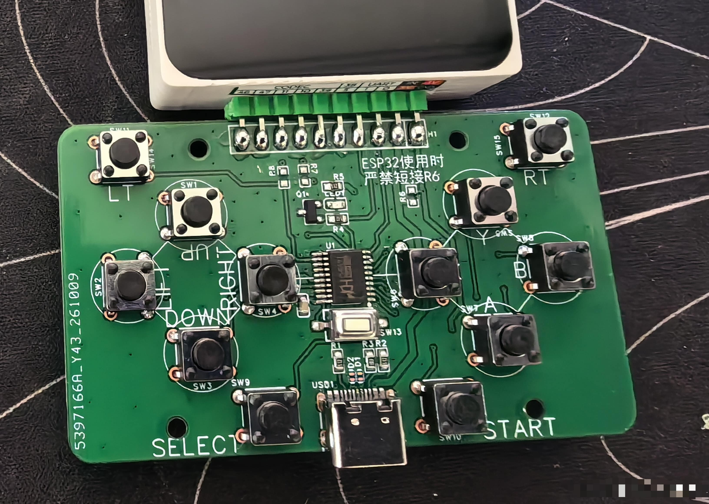
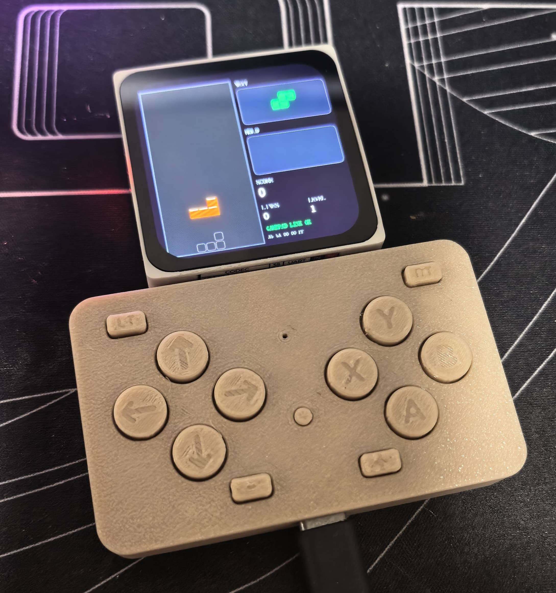

# ESP-Mosaico 两用游戏手柄 —— USB 手柄 + 串口双路上报

> 一块 **12 键游戏手柄面板**控制板（街机布局）：插上 USB 就是一只**免驱手柄**，
> 同时通过串口把按键状态**实时发给你的主控单片机**——“两用”即指此。
> 主控：WCH **CH552T**（TSSOP-20，8051 核 + USB）。
> 既可以直接烧写随附的 `hex`，也可以用 PlatformIO 一键从源码编译。

**作者**：阿飘Victor　|　**许可**：GPL-3.0（整个工程，应用层代码另有 MIT 授权）

---

## 📷 实物照片

| PCBA | 带外壳运行 |
|:--:|:--:|
|  |  |

---

## ✨ 功能特性

| | |
|---|---|
| **12 个按键** | 全部内部上拉、按下接地，软件消抖 ≈16 ms |
| **USB HID 手柄** | 免驱；按键顺序严格遵循 **W3C《标准手柄》映射**（`A B X Y LB RB LT RT Back Start`），浏览器 / 测试网站 / SDL2 / 模拟器都能正确对号 |
| **串口上报** | `P3.1 (TXD)` 输出 5 字节二进制帧，**19200 8N1**，带 XOR 校验；**状态变化立即上报**，空闲时约 **400 ms** 心跳 |
| **双路并行** | USB 手柄与串口上报**同时工作**，互不干扰 |
| **体积小** | Flash **3709 B / 14336 B（26%）**，零编译告警 |
| **附带自测工具** | PC 端脚本：串口帧解码、HID 报告读取、设备枚举检查 |

---

## 1. 硬件

### 1.1 元件清单（参考）

| 位号 | 规格 | 数量 | 说明 |
|:--:|---|:--:|---|
| U1 | **CH552T**（TSSOP-20） | 1 | 主控，内置 USB，无需外部晶振 |
| C1 | 0.1 µF | 1 | `VCC` 去耦（手册要求） |
| C2 | 0.1 µF | 1 | `V33` 去耦（见下方说明） |
| SW1~SW12 | 6×6 轻触开关 | 12 | 一端接 MCU 引脚，一端接 **GND** |
| — | USB 座 / 焊盘 | 1 | `D+`/`D-` 直连 `P3.6`/`P3.7` |
| R1 | 10 kΩ | 1 | 仅烧录用：把 `D+` 上拉进 bootloader，正常工作时可断开 |

> **`V33` 怎么接**（CH552 手册 4. 引脚定义）：
> 供电 **< 3.6 V** → `V33` 与 `VCC` 短接；
> 供电 **> 3.6 V** → `V33` 只挂 0.1 µF 电容，**不要**接 VCC。
>
> **`RST` 内置下拉，其余 GPIO 默认带上拉**（手册原文）。所以按键直接接 GND 即可，**无需外部上拉电阻**。

### 1.2 引脚分配（CH552T / TSSOP-20）

| 封装脚号 | 引脚 | 用途 | 板丝印 | 手柄功能 | 串口掩码位 |
|:--:|:--:|---|:--:|:--:|:--:|
| **7**  | P1.0 | 按键输入 | SW1  | D-Pad 上 | bit0 |
| **8**  | P1.1 | 按键输入 | SW2  | D-Pad 左 | bit1 |
| **17** | P1.2 | 按键输入 | SW3  | D-Pad 下 | bit2 |
| **16** | P1.3 | 按键输入 | SW4  | D-Pad 右 | bit3 |
| **2**  | P1.4 | 按键输入 | SW5  | Y | bit4 |
| **3**  | P1.5 | 按键输入 | SW6  | X | bit5 |
| **4**  | P1.6 | 按键输入 | SW7  | A | bit6 |
| **5**  | P1.7 | 按键输入 | SW8  | B | bit7 |
| **1**  | P3.2 | 按键输入 | SW9  | SELECT → Back | bit8 |
| **11** | P3.3 | 按键输入 | SW10 | START → Start | bit9 |
| **12** | P3.4 | 按键输入 | SW11 | LT | bit10 |
| **13** | P3.5 | 按键输入 | SW12 | RT | bit11 |
| **9**  | **P3.1** | **UART0 TXD → 主控 RX** | — | — | — |
| **10** | P3.0 | UART0 RXD（**预留，本例未用**） | — | — | — |
| **14** | P3.6 | USB **D+** | — | — | — |
| **15** | P3.7 | USB **D−** | — | — | — |
| **6**  | RST | 复位（不用可悬空） | — | — | — |
| **19** | VCC | 电源（3.3 V 或 5 V） | — | — | — |
| **20** | V33 | 见 1.1 说明 | — | — | — |
| **18** | GND | 地 | — | — | — |

### 1.3 最小接线

```
              ┌──────────────────────┐
   SW1~SW8 ───┤ P1.0~P1.7            │
   SW9~SW12 ──┤ P3.2~P3.5            │
              │                      │
   主控 MCU RX├─ P3.1 (TXD)          │  CH552T
              │                      │  TSSOP-20
   USB D+ ────┤ P3.6 (UDP)           │
   USB D− ────┤ P3.7 (UDM)           │
              │                      │
   0.1µF ─────┤ VCC / V33 / GND      │
              └──────────────────────┘
   按键另一端全部接 GND；主控与 CH552 必须共地
```

> ⚠️ **`P1.2` / `P1.3` 同时是晶振脚 `XI` / `XO`**，本固件已显式关闭外部晶振把它们释放为普通 IO。
> 自己改代码时**千万别去掉那几行**，否则这两个按键会疯狂抖动（详见 `docs/踩坑记录.md`）。

### 1.4 硬件资料

文件都在 [`hardware/`](hardware) 目录：

| 资料 | 文件 |
|---|---|
| 原理图 | `ESP-Mosaico两用游戏手柄原理图.pdf` |
| Gerber（可直接打板） | `Gerber_PCB1_1_2026-10-17.zip` |
| BOM（Excel） | `BOM_ESP-Mosaico_gamepad_1.1_Schematic1_1_2026-10-17.xlsx` |
| 外壳 3D 模型（STEP） | `外壳3D文件.STEP` |
| 实物照片 | `pcba.jpg`（PCBA）、`assembled.jpg`（带外壳运行） |

---

## 2. 快速开始

### 2.1 直接烧录（不用编译）

`firmware/` 里已备好编译产物：

| 文件 | 说明 |
|---|---|
| `ESP-Mosaico_gamepad_v1.0.hex` | **推荐**，用 WCHISPTool / vnproch55x 烧写 |
| `ESP-Mosaico_gamepad_v1.0.bin` | 二进制镜像 |

**进 bootloader**：把 `D+`（P3.6）经 10 kΩ 上拉到 3.3 V/5 V，再上电或复位。
用 WCH 官方 **WCHISPTool**（Windows）即可识别并下载。详见 `firmware/README.md`。

### 2.2 从源码编译（PlatformIO）

```ini
; platformio.ini 已配好，无需修改
[env:ch552t]
platform = unit_ch55x      ; 第三方 CH55x 平台(SDCC + 厂商库)
board    = unit_ch552
board_build.f_cpu = 16000000
```

```bash
pip install platformio
pio run                    # 编译，产物在 .pio/build/ch552t/
pio run -t upload          # 烧录(板子需已进 bootloader)
```

---

## 3. 使用

### 3.1 当 USB 手柄

插上 USB，Windows 会免驱识别为 **`HID-compliant game controller`**，直接在
`Win+R → joy.cpl` 里就能逐个按键测试；浏览器可用 gamepad-tester 之类的页面。

| 面板按键 | 手柄功能（W3C 标准位） |
|---|---|
| SW1~SW4 | D-Pad 上/左/下/右（同时驱动左摇杆满偏，可关） |
| SW5~SW8 | Y / X / A / B |
| SW9 / SW10 | Back / Start |
| SW11 / SW12 | LT / RT |

### 3.2 当串口面板（接主控单片机）

把主控的 `RX` 接到 CH552 的 **`P3.1`**、两者共地，用 **19200 8N1** 接收即可。
完整的帧格式、按键掩码表、以及**可直接抄用的 C 解析代码**见
👉 **[`PROTOCOL.md`](PROTOCOL.md)**

---

## 4. 目录结构

```
ESP-Mosaico_gamepad/
├── README.md            本文件
├── PROTOCOL.md          串口协议 + 按键键值对照表(给主控开发者)
├── LICENSE              整体许可(GPL-3.0 全文)
├── LICENSE-MIT          应用层代码的额外 MIT 授权
├── LICENSE-CC-BY-SA-3.0.txt  第三方 USB 库的原始许可全文
├── THIRD-PARTY.md       第三方代码归属
├── platformio.ini       PlatformIO 工程配置
├── src/                 固件源码
│   ├── main.c             主循环:按键扫描 → 手柄上报 + 串口上报
│   ├── config.h           USB VID/PID、字符串描述符
│   ├── keypad.h/.c        12 键扫描 + 消抖
│   ├── gamepad.h/.c       键位 → 手柄报告映射
│   ├── uart.h/.c          UART0 单向发送(帧格式)
│   ├── usb_hid.h/.c       HID 设备层(非阻塞发送)
│   ├── usb_descr.h/.c     USB 设备/配置/报告/字符串描述符
│   ├── usb_handler.h/.c   USB 中断与枚举处理
│   └── usb.h              USB 常量与结构体
├── firmware/            预编译固件(hex/bin) + 烧录说明
├── hardware/            原理图 PDF / Gerber / 外壳 STEP / 实物照片
├── docs/
│   └── 踩坑记录.md        开发中踩过的 4 个真坑,含手册依据
└── tools/               PC 端自测脚本(Windows PowerShell)
    ├── test_serial.ps1    解析串口帧,打印键名与帧间隔统计
    ├── test_hid.py        直接读取 HID 报告(需 pip install hidapi)
    ├── check_device.ps1   检查是否被识别成 HID 手柄
    └── test_xinput.ps1    XInput 通道探测
```

---

## 5. 常见问题（FAQ）

**Q：为什么不用 `045E:028E`（微软 Xbox360 的 VID/PID）？**
A：**千万不要**。填了这个 ID，Windows 会按 INF 把它匹配给 **XInput 驱动（xusb22 / XnaComposite）**，
走真·XInput 协议（厂商自定义接口 + 20 字节报文 + 握手），而本固件是标准 HID 类手柄，
结果就是**驱动占着设备却读不到数据**（实测 `XInputGetState` 返回 1163），设备完全不可用。
本工程默认用中性的 `0079:0006`，Windows 加载通用 HID 驱动，正常可用。
若某些游戏只认 XInput，请在 **PC 侧**用开源的 **ViGEmBus** / **x360ce** 桥接，设备端不用动。

**Q：`P1.2`/`P1.3` 上的按键一直乱抖？**
A：这两个脚还是晶振脚 `XI`/`XO`。见 `docs/踩坑记录.md`，`main.c` 里有对应修复。

**Q：手柄能用，但游戏里没反应？**
A：先在 `joy.cpl` 里确认按键有响应，再看游戏的手柄类型设置（切到 DInput / 通用手柄）。

**Q：想改按键数量 / 换引脚？**
A：改 `keypad.c` 的 `KP_init()`/`kp_raw()`、`keypad.h` 的掩码宏，以及 `PROTOCOL.md` 的对照表。

**Q：串口想加接收（双向）？**
A：把 `SCON` 的 `REN` 置 1、打开 `ES` 即可，`P3.0 (RXD)` 已预留。

---

## 6. 许可与致谢

| 范围 | 许可 | 许可文件 |
|---|---|---|
| **整个工程**（含固件产物、文档、原理图 / Gerber / 外壳 / BOM） | **GPL-3.0** | [`LICENSE`](LICENSE) |
| **应用层代码**（额外授权，可单独取用）<br>`main.c`、`config.h`、`keypad.*`、`gamepad.*`、`uart.*`、`usb_hid.*`、`usb_descr.*`、`tools/` | **MIT** | [`LICENSE-MIT`](LICENSE-MIT) |
| `usb.h`、`usb_handler.c`、`usb_handler.h`（第三方） | CC BY-SA 3.0 / GPL-3.0 | [`THIRD-PARTY.md`](THIRD-PARTY.md) |

> **为什么整体是 GPL-3.0？** USB 底层那三个文件来自 GPL-3.0 的开源库，固件把它们链接进了同一个二进制，
> 按 GPL 的规定整个产物必须按 GPL-3.0 分发。这不影响你自己使用，也**不影响商用**（GPL 允许商用）；
> 只是你二次分发时，必须同样开放源码并保留许可声明。
> 应用层文件**另外**提供 MIT 授权，你可以单独取用而不受 GPL 约束。

- Copyright © 2026 **阿飘Victor**，设计与实现。
- `src/usb.h`、`src/usb_handler.c`、`src/usb_handler.h` 来自 **Stefan Wagner** 的 CH55x 开源库
  （经 UNIT-Electronics-MX 整理），采用 **CC BY-SA 3.0 / GPL-3.0**，详见 [`THIRD-PARTY.md`](THIRD-PARTY.md)。
- 平台与寄存器头文件来自 **WCH（南京沁恒）** 官方资料。

**致谢**：Stefan Wagner（ch554_sdcc 库）、UNIT-Electronics-MX（unit_ch55x PlatformIO 平台）、WCH（芯片与手册）。
